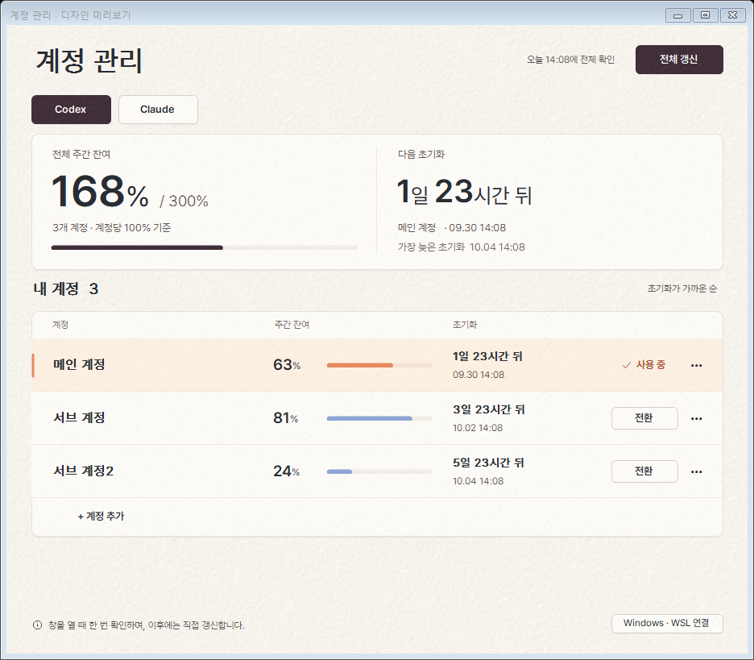

# Codex + Claude Usage Indicator

See how much weekly usage you have left, then choose the account for your next session. A compact Windows widget and one account manager bring Codex, Claude Code and connected WSL Codex environments together.

**Windows · 한국어 / English · Manual account switching**


Blue is Codex; orange is Claude. Choose **all-model weekly** or **Fable weekly** for the Claude number from the right-click menu.



- **See what is left across your Codex accounts.** Check their remaining weekly percentages and the next reset without signing out of your current account.
- **Choose the account you want to use.** Switch Codex manually. For Claude, switch accounts in the Claude app; every account keeps this PC's Code sessions in its list.
- **Keep Windows and WSL Codex in step.** Connect an installed WSL environment once, then include it when you switch accounts.

Screenshots use synthetic accounts and usage. This is an unofficial community project.

[Download the Windows release](https://github.com/extsvforest/codex-weekly-usage-indicator/releases/latest) · [Installation](#install-from-a-release) · [Privacy](PRIVACY.md)

## Widget

The widget appears while Codex Desktop is running and hides when Codex exits or another app is fullscreen. Drag it to move; double-click to refresh; right-click for account management, display choices, language and other controls. Its hover details stay in place while you read and never take keyboard focus.

Choose **Claude display → All models · weekly remaining / Fable · weekly remaining** to change the right-hand number. This changes the display immediately without requesting usage. A new installation starts with all-model weekly; existing installations keep Fable until you choose otherwise. If the selected limit is absent or has passed its reset, the number is **—**. It never silently substitutes another limit. Turning Claude off leaves a single Codex panel and stops Claude usage requests.

Codex refreshes every minute while active. Claude usage requests are at least ten minutes apart per account, including manual refreshes and failed attempts. Checking one account does not delay another; duplicate profiles for the same verified account share the interval. This is the widget's conservative polling interval, not a published provider requirement. The tooltip lists the selected Claude window first, followed by the other weekly window and the five-hour limit. Overall and Fable percentages are separate limits; they are not added together.

Temporary Claude failures can keep a recent, unexpired value visible with its last check time and retry time. Each window expires independently, and no recovery value is used after 24 hours. Missing reset times stay unknown. Account verification or response-format failures clear the affected cached value.

## Codex accounts

Open **Account manager… / 계정 관리…** from the widget or tray menu, or double-click the tray icon. Choose the **Codex** tab.

1. **Save your current account.** Choose **Save current account**. Rename it from its **···** menu whenever you like.
2. **Add another account.** Choose **+ Add account** and complete the official browser sign-in. Your current Codex session stays signed in.
3. **Check the balances.** Opening a new manager window checks saved Codex accounts once. Use **Refresh all** for another complete check or a row's **···** menu to refresh just that account.
4. **Switch when ready.** Choose **Switch**, save your work, and close Codex Desktop and its terminal or IDE sessions. Confirm the switch once they have stopped. The tool applies the saved login and tries to reopen Codex; check the account there.

The list puts the soonest reset first. Three accounts fit in the default window on a sufficiently tall display. Names appear in the manager and hover details, keeping the small widget focused on percentages.

In the screenshot, **63% + 81% + 24% = 168% out of 300%**. Each account contributes 100% when full. Different plans can have different actual quotas, so this sum does not represent an equal number of messages or tokens. A connected Windows/WSL pair counts as one account.

**Next reset** identifies the first account to reset. **Latest reset** gives the last reset among the accounts; it is not a deadline for spending the entire combined balance. Each account follows its own reset time.

Changing tabs, language or focus does not request another full refresh. If a query fails, an account changes or a reset passes, the manager distinguishes previous values from current observations and withholds an incomplete total. Refreshing one account does not certify a new full total.

<details>
<summary>Saved Codex logins and interrupted operations</summary>

Saved logins are encrypted for your Windows user. Inactive-account usage checks use the official local app-server in a private temporary `CODEX_HOME`; they do not replace the active login. If the official client refreshes credentials, the new credentials are saved even when the usage request fails or is canceled.

An interrupted credential operation offers recovery. Recovery compares the actual current account before proceeding and does not overwrite a newer, different sign-in. If credentials are already saved and only temporary files remain, **Clean up temporary files** can finish cleanup while Codex stays open. Closing the manager during a batch cancels the request and waits for safe cleanup.

Local file-based ChatGPT authentication is supported. Keyring and managed authentication configurations are not changed. See [PRIVACY.md](PRIVACY.md) for storage and recovery details.

</details>

## Claude Code accounts

1. Open the **Claude** tab and choose **Connect existing account** to register the Claude Code account you already use.
2. Choose **+ Add account** and sign in through the official Claude Code login window. Each additional account gets its own official login profile, used for its usage checks.
3. Switch accounts in the Claude desktop app itself: sign out, then sign in with the other account. The row of the account the app is using shows **In use**, and the widget follows it. While the app is signed out, signed in to an account not registered here, or still confirming a switch, the widget shows `—` with the reason instead of another account's usage.

### Keep your Code sessions in every account

The Claude desktop app lists Code sessions per account in its profile folder (`%APPDATA%\Claude`, or `%LOCALAPPDATA%\Claude-Data\claude_…` once the Microsoft Store version has moved it there; the widget finds and follows it), so signing in with another account used to show an empty list even though the conversations were still on this PC. The widget fixes the list, not the login: it adds each registered account's missing Code sessions to the other accounts' lists. The accounts Claude is not showing are filled while it runs; the account it shows is filled when Claude is fully closed. The next time you open Claude with either account, the same sessions are there, and opening one continues the same conversation.

- It adds entries, and brings an entry up to date when you continued that conversation in another account (below). It never deletes a list entry, never touches conversations themselves, and never reads or copies sign-in data.
- While Claude runs, it writes only the lists of accounts Claude has not shown for two minutes (just after a switch the app is still ending the previous account's sessions), and only after following the app's log for two minutes. Signing out lets it fill the account you sign in to next before Claude reads that list; the account you signed out of is left alone until Claude shows the next one. If you switch accounts and the new account still lacks sessions, the widget says how many and arms **Reopen after quitting** for you: quit Claude once, the sessions are added and Claude reopens (once, within 30 minutes). Cancel it on the account tab if you meant to stop.
- A conversation continued in another account is listed once, in its newest state: the entry you already had takes that state in place and keeps its name, pin and settings. When that is not safe (it was continued separately here, is still importing, an earlier part is being written, it has a worktree here, or its history does not match), the newest state is added beside it as before. An older copy the widget made earlier is archived (find it in the app's archive), never deleted.
- A copy keeps its original's name. Rename a session in one account and its copies in the other accounts take the new name at the next fill, unless you renamed, continued or used that copy in its own account.
- The widget itself never changes pins or groups. Ask Claude to align them instead (below).
- Archived sessions, folderless scratch sessions, remote and Cowork sessions, sessions whose worktree Claude has not made yet, and sessions whose folder or conversation file is gone are left out. A session in a worktree is added in its folder; the worktree itself stays with the account that made it. A session you delete in one account's list is not added back to that account.
- After a Claude update the widget checks that the app still behaves the way this relies on. If the stores or log lines it follows are gone, it pauses filling and says so on the account tab. If only the app's deletion safeguard reads differently from the versions reviewed, filling goes on, and the account tab and a tray message ask you to archive sessions rather than delete them until that version is reviewed.

### Keep session names, pins and groups in step

After the Claude app switches to another account, run `/claude-session-sync` in any Code session. The skill asks the widget for a plan and applies it with the Claude app's own session tools, so the app keeps the result. It runs only when you call it.

It follows the newest change. For each session's name, pin and group, and for the list of groups and its order, the account where it was changed most recently wins, wherever that was. The widget notes each account's sidebar when Claude comes to that account and whenever you run this, so it can tell what changed in each account and when. Right after switching, running it makes this account look like the one you used last. An account you only passed through without running it overwrites nothing, and what you change here, before or after running it, stays here and reaches the others when you run it there.

- The widget makes the plan, so it needs to be running. It reads titles from each account's session records, pins from the list the app's sidebar shows, and groups and their order from the app's own storage, and it remembers what the plan sets out to change, so a run that stops part way is finished next time rather than taken for your choice.
- Groups out of place are renamed out of the way and made again at the end in order (the app adds new groups at the end and cannot reorder them); then sessions are moved, pinned and renamed, and groups left empty are deleted, including groups the account you follow no longer has. Deleting a group never deletes a session. A session the widget copied into another account brings over only what you chose there.
- If a conversation still shows twice (an older state beside the newest), Claude offers to archive the older one; you can bring it back from the app's archive. Nothing is deleted, and sessions only one account has stay as they are.
- When it is done, Claude shows the accounts' pins and groups side by side and says why anything still differs. The app's tools cannot fold or unfold a group, so Claude names the groups to fold.
- Pin order is left alone.

The summary adds up the overall weekly balance of every Claude account at 100% per account, like the Codex total, with the soonest and the latest reset. Opening the Claude tab checks every signed-in account once, the in-use one first; **Refresh** in the upper-right corner does it again, and **Check this account's usage** in an account's **···** menu checks just that one. Manual and widget checks share a ten-minute interval for each account: an account checked within the last ten minutes reuses that observation instead of a new check, and temporary failures delay retries only for the affected account. An account that failed, needs a sign-in or shows a previous value withholds the total, which then reads as a partial balance. Accounts are not polled in the background. The **···** menu also provides account details, rename, sign in again, sign out and removal from the list. **Remove from list** keeps that profile's login files; use **Sign out** first if you want the official CLI to end its login.

Usage requires a working [Claude Code CLI sign-in](https://code.claude.com/docs/en/authentication). Being able to chat in the Claude desktop app does not verify the CLI's sign-in. If authentication is missing or another account is signed in, the account tab shows the reason and a **Sign in again** button. Sign in with the account originally connected to that row. The tool keeps the saved identity, and it does not display another account's usage under the old label. A malformed status response is reported as an error, not as an expired login.

## Connect WSL Codex

Choose **Windows · WSL** in the Codex tab, start the WSL distribution you want to use, and press **Find environments**. Only a running environment with a native Linux Codex CLI and supported personal file-based authentication can be connected. The tool does not install a missing CLI, start unrelated distributions or change unsupported authentication settings. If the official login does not open your browser, use **Open sign-in page**. The temporary link stays in memory and is cleared when login ends or is canceled.

For each account you want to switch:

1. Select the WSL environment and its corresponding saved Windows account.
2. If WSL already uses that account, finish and close its Codex jobs, then choose **Connect current WSL login**. Otherwise choose **Sign in to selected account** and complete the official login. This additional login is isolated and can be prepared while existing jobs continue.
3. Enable **Switch together with Windows** after connecting the logins.

Before the first switch, connect **both the current WSL account and the destination account**. WSL logins are saved independently from Windows logins; Windows credential files are not copied over as a shortcut. An identity check must match the selected account before a binding is saved.

Actual capture and switching require WSL Codex processes, including app and IDE connections, to be stopped. The tool does not kill those processes. If Windows is already on the account you want, its row's **···** menu can apply that account to the connected WSL environments without switching Windows again.

Windows and WSL cannot be updated in one atomic filesystem operation. If a switch is interrupted, the manager keeps an encrypted recovery record and shows what still needs attention. **Recover account switch** completes verification where possible. **Stop WSL linking** instead leaves every environment's current login untouched, disables linked switching and archives the encrypted recovery record. It does not roll back or write authentication files.

## Widget size

Choose **Size… / 크기…** in the widget or tray menu to set the widget's size in 1% steps, from 50% to 200%; 100% is the original 272 × 64 size. Each value shows on the widget at once. **OK** keeps it and **Cancel** puts back the size it had. A new size keeps the widget's centre, settles again on the middle line of a taskbar it sits in and stays on the screen. The size is saved locally and does not follow the display's scale.

## Language

Choose **Language / 언어 → 한국어 / English** in the widget or tray menu. Menus, account management, dialogs, usage details and known application errors change immediately. An idle manager keeps its size and latest observations. Finish or cancel a running account operation, and close the size window, before changing language.

The choice is saved locally. Existing installations keep Korean; new installations use Korean on Korean Windows and English otherwise. Account names, identities and usage values are not translated. Windows dialogs and external diagnostic text can follow their own language settings.

## Requirements

- Windows 10 or 11 and [.NET 8 Desktop Runtime](https://dotnet.microsoft.com/download/dotnet/8.0)
- Codex Desktop installed and signed in
- Optional Claude support: a current native Claude Code for Windows with `/usage`, `auth` and `--safe-mode`
- Optional WSL switching: a running WSL distribution with native Linux Codex CLI and supported file-based ChatGPT authentication
- .NET 8 SDK only when building from source

## Install from a release

1. Download and extract the Windows zip from [Releases](https://github.com/extsvforest/codex-weekly-usage-indicator/releases).
2. Review the included PowerShell scripts.
3. Open a standalone Windows PowerShell window outside packaged apps such as Codex, change to the extracted directory, and run:

```powershell
.\scripts\install.ps1
```

From a terminal inside a packaged app (an agent's shell in Codex or Claude, for example), run `.\scripts\install-outside.ps1` instead: it runs the installer through a one-off scheduled task of your user, with no window, and checks that the installed executable is the one in the zip.

To see which Claude profile folder the widget found, run `& "$env:LOCALAPPDATA\CodexWeeklyUsageIndicator\WeeklyUsageIndicator.exe" --claude-data`. It prints the folder, why it was chosen, how many lists and sessions it holds, and whether the installed Claude version is one the session lists were reviewed with. Only names, counts and times are read.

The app is installed to `%LOCALAPPDATA%\CodexWeeklyUsageIndicator`. A per-user `CodexWeeklyUsageIndicator-<Windows SID>` scheduled task starts its supervisor at sign-in with normal user privileges and no stored password. Installation starts the task immediately. Two processes from the same EXE are expected: the supervisor and one widget.

The supervisor retries an abnormal widget exit after one minute. Choosing **Close** from the widget menu ends both normally. To start again before your next Windows sign-in, run the scheduled task or the installer. Launching the EXE directly does not enable supervision.

Run installation and removal outside packaged app terminals. Windows can redirect their AppData writes into a location Task Scheduler cannot see; both scripts check the actual directory before changing tasks or processes. Release binaries are unsigned, and SHA-256 checksums are included with each release.

To uninstall:

```powershell
.\scripts\uninstall.ps1
```

Uninstall removes the app and scheduled task. It **preserves saved Codex accounts, WSL recovery records and Claude profile folders**, so reinstalling does not discard your logins. Claude profile folders can contain official CLI credentials and links to your original work; do not recursively delete their linked contents. See [PRIVACY.md](PRIVACY.md) before removing saved data.

## How it works

The WinForms widget reads `account/rateLimits/read` through the official local Codex app-server and selects the window closest to seven days. Claude usage comes from the official CLI's built-in `/usage`, run in safe mode without a shell, browser integration or persistent session and with `--max-turns 0`. Responses reporting a model turn or nonzero cost are rejected. The app does not read Claude tokens or implement its own OAuth flow.

One local Claude recovery snapshot holds percentages, reset times, its check time and an opaque profile/account key. It cannot be reused for a different verified account. A new process attempts a live request first; temporary failures may use the matching snapshot for up to 24 hours, with each expired window withheld independently. Claude's own last-known output is not relabeled as a fresh check.

Account changes are manual. There is no quota-based rotation, request proxy, pooled subscription quota, usage timeline or per-person attribution. This convenience tool does not establish that any particular multi-account usage pattern is permitted by the service terms.

The local Codex app-server method and Claude Code's usage text are changeable interfaces. An upstream change can require an app update.

## Build from source

```powershell
.\scripts\build.ps1
```

The executable is written to `dist\WeeklyUsageIndicator.exe`. The script runs the regression suite before publishing; release builds omit debug paths and symbols. Synthetic design captures live under `docs/design/`.

## License

[MIT](LICENSE). Bundled Pretendard fonts use the SIL Open Font License; see [THIRD_PARTY_NOTICES.txt](THIRD_PARTY_NOTICES.txt).
