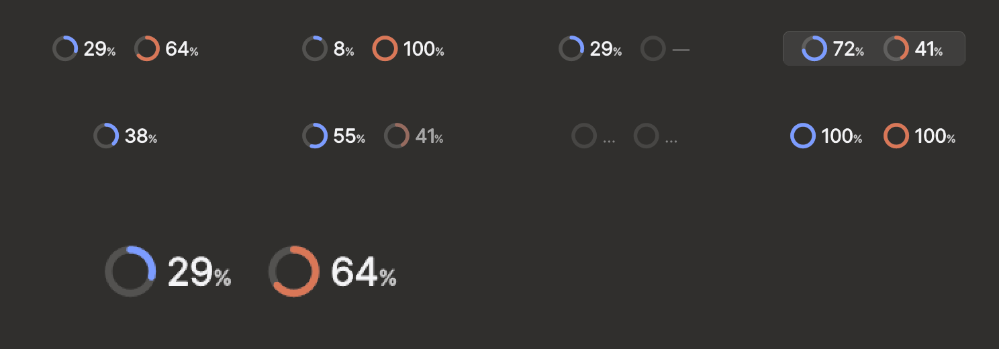

# Widget face · 2026-11-14

The user asked for a prettier widget inside the same 272 × 64 window, which they
keep inside the taskbar. This face was applied on 2026-11-14 as the agent's
recommendation. The user's verdict on the installed widget is still to come, so
nothing here is an accepted taste yet.

## What changed

- Each provider is a ring that fills clockwise from twelve o'clock with what
  remains, and the number beside it. The percent sign is smaller and quieter than
  the digits.
- Inside a taskbar the widget has no surface: the two gauges sit on the bar like
  its own items, in white on a dark bar and in dark on a light one. The pointer
  lights up a faint sheet, as the bar's own items answer. Dropped inside a
  taskbar, the widget settles on the bar's middle line.
- Anywhere else it floats on a dark surface with soft, anti-aliased corners, so
  the numbers read over any window.
- A share kept through a transient failure is drawn fainter. A provider without
  a value keeps its place with an empty ring and a dash.

Kept from the earlier decisions: the window's size, Codex blue on the left and
Claude terracotta on the right, no provider names on the face, white numbers on
dark, details in the hover tooltip.

## What the old face showed on the user's display

The window does not scale with the display, but its 13-point number did. At 200%
the number stood 35 pixels tall in a 64-pixel window and sat on its bar. The new
face is drawn in pixels of the window, so it reads the same at every scale.

## Compared

Every candidate was drawn with GDI+ at the real size over a capture of the user's
taskbar (the captures hold the user's screen and stay out of this repository).

- **Rings, no surface on the taskbar** — chosen. The dark slab was the least
  necessary part of the old face: on the bar the gauges need nothing behind them.
- **Rings in a dark capsule everywhere** — the floating look. On the taskbar it
  reads as a box on a bar.
- **Rings on an ivory paper chip** — closest to the account manager's paper and
  pretty as an object, but the brightest thing on a dark bar, and it turns the
  numbers dark where white was decided. Offered to the user as the alternative.
- **Number over a bar, tidied** — the old structure with better spacing. Cleaner,
  not meaningfully prettier.
- **Number over ten segments** — reads as a row of dots at this size.
- **Paper-leaf level gauges** (the manager's header motif) — the fold is lost at
  this size and the block reads as an app icon.

A mark for the window's remaining time on the same ring (a hairline cut, showing
whether usage runs ahead of the week) was drawn and left out: without a legend it
reads as a flaw in the ring.

## References opened

- iStat Menus: ring gauges with light numerals, a smaller unit and a dim track.
- Apple's complication guidance: a closed ring for a share of a whole.
- Stats (macOS menu bar): how little a bar-resident gauge needs around it.

## Images

Synthetic values, drawn by the production painter (`--widget-face-preview`):
[dark taskbar](face-dark-taskbar.png), [light taskbar](face-light-taskbar.png),
[floating over a light window](face-floating-over-light.png),
[floating over a dark window](face-floating-over-dark.png), and the
[face alone](widget.png).

## Validation

`WidgetFaceTests` reads the composed picture: grounds, the pointer's sheet,
provider sides and colours, clockwise growth, missing and stale shares, and that
a new value of as many digits shifts nothing. The layered window itself was
looked at on the real taskbar and floating (`--widget-native-preview`). Hover and
drag on the installed widget are the user's to try.
